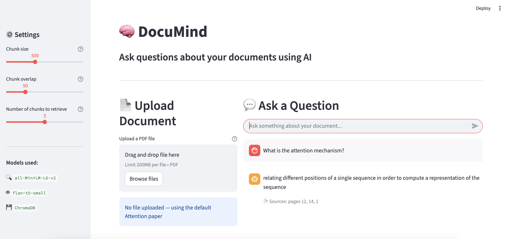

# documind-rag-pipeline
End-to-end RAG pipeline using LangChain, ChromaDB and HuggingFace — ask questions to your own documents

# 🧠 DocuMind — RAG Pipeline


An end-to-end Retrieval Augmented Generation (RAG) pipeline
that lets you ask questions about your own documents using
local open-source AI models — no API key needed.

Built with LangChain, ChromaDB, HuggingFace, and Streamlit.

---

## 📌 Project Highlights

- Full RAG pipeline — ingestion, chunking, vectorization,
  retrieval, prompting, generation and output
- Runs completely locally — no OpenAI key, no cost
- Modular design — swap any component independently
- Interactive Streamlit UI — upload any PDF and chat with it
- Built first in Jupyter notebooks for understanding,
  then refactored into clean Python modules

---

## 🗺️ The RAG Pipeline

```
Your PDF
    ↓
STEP 1: INGESTION     — load the document
    ↓
STEP 2: CHUNKING      — split into small pieces
    ↓
STEP 3: VECTORIZATION — convert chunks to embeddings
    ↓
STEP 4: STORAGE       — save in ChromaDB vector database
    ↓
STEP 5: RETRIEVAL     — find relevant chunks for question
    ↓
STEP 6: PROMPTING     — combine context + question
    ↓
STEP 7: GENERATION    — local LLM writes the answer
    ↓
STEP 8: OUTPUT        — grounded answer returned to user
```

---

## 🗂️ Project Structure

```
documind-rag-pipeline/
│
├── notebooks/
│   ├── 01_ingestion.ipynb
│   ├── 02_chunking.ipynb
│   ├── 03_vectorization.ipynb
│   ├── 04_retrieval.ipynb
│   ├── 05_prompting_generation.ipynb
│   └── 06_full_pipeline.ipynb
│
├── src/
│   ├── ingestion.py
│   ├── chunking.py
│   ├── vectorstore.py
│   ├── retriever.py
│   ├── prompt.py
│   └── generator.py
│
├── data/
│   └── documents/
│
├── docs/
│   └── app_screenshot.png
│
├── app.py
├── main.py
├── requirements.txt
└── README.md
```

---

## 📸 App Screenshot



---

## 🛠️ Tech Stack

| Tool | Purpose |
|------|---------|
| LangChain | Pipeline orchestration |
| ChromaDB | Vector database |
| sentence-transformers/all-MiniLM-L6-v2 | Local embeddings |
| google/flan-t5-small | Local LLM generation |
| Streamlit | Interactive UI |
| PyPDF | PDF loading |
| Python 3.9 | Core language |

---

## ▶️ How to Run

### 1. Clone the repo
```bash
git clone https://github.com/HarithaRetnakaran/documind-rag-pipeline.git
cd documind-rag-pipeline
```

### 2. Set up environment
```bash
python -m venv venv
source venv/bin/activate
pip install -r requirements.txt
```

### 3. Add a document
Put any PDF in `data/documents/` or upload via the app.

### 4. Run from terminal
```bash
python main.py
```

### 5. Run the Streamlit app
```bash
streamlit run app.py
```

Open http://localhost:8501 in your browser.

---

## 📓 Notebooks

The `notebooks/` folder walks through each step of the
pipeline individually — great for understanding how
RAG works from the ground up.

| Notebook | What it covers |
|----------|---------------|
| 01_ingestion | Loading PDFs with LangChain |
| 02_chunking | Splitting text with overlap |
| 03_vectorization | Embeddings and ChromaDB |
| 04_retrieval | Semantic search |
| 05_prompting_generation | Prompt building and LLM |
| 06_full_pipeline | Complete end to end flow |

---

## 🧩 Modular Design

Each component is independent and swappable:

```python
# Swap the LLM — change only generator.py
# Currently: google/flan-t5-small (local, free)
# Could be : mistral-7b, llama-3, GPT-4

# Swap the vector store — change only vectorstore.py
# Currently: ChromaDB
# Could be : Pinecone, Weaviate, FAISS

# Swap the embeddings — change only vectorstore.py
# Currently: all-MiniLM-L6-v2
# Could be : text-embedding-ada-002, e5-large
```

---

## 👩‍💻 Author

**haritha-1234**
Data Science trainer | Hamburg, Germany
[LinkedIn](http://linkedin.com/in/haritha-retnakaran-341448162/) .
[GitHub](https://github.com/haritha-1234)